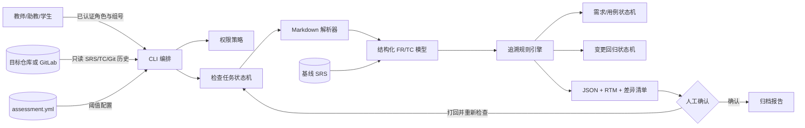

# 架构与构件图

## 1. 系统边界

- 系统内：读取目标仓库、解析结构化 FR/TC、建立双向 RTM、执行一致性规则、比较基线、驱动变更回归、输出 JSON/Markdown 报告。
- 边界外系统：校内 GitLab 提供仓库与历史，统一身份认证提供已核验角色。AI 服务是可选初筛能力，当前版本不接入，也不参与追溯结论定稿。
- 明确不做：不执行被检查仓库构建/测试；不评价用例设计质量；不向目标仓库写入；不做 A 的贡献统计或 C 的 AI 合规审计；不对自然语言自动给出确定追溯结论。

## 2. 构件图

系统对目标仓库始终只读，不执行其代码，也不向其写入任何内容。正常检查路径是输入解析、规则分析、生成报告和人工确认；人工打回报告时可以重新进入检查流程，但不会修改目标仓库。报告只写入独立输出目录。
