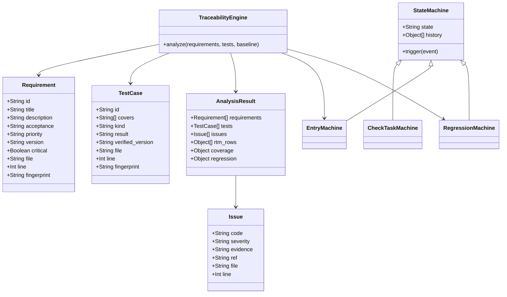
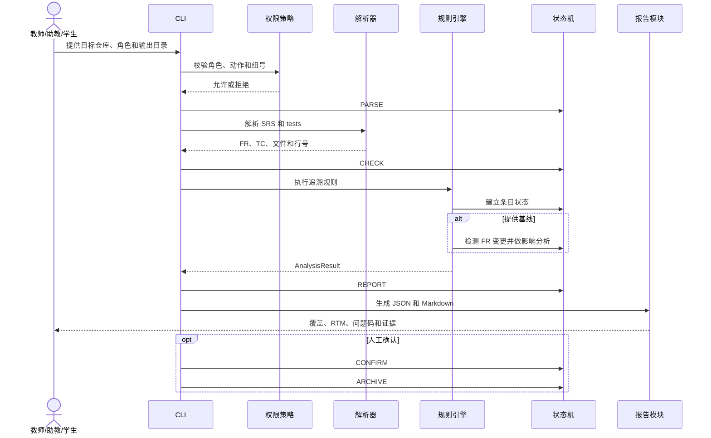

# 详细设计

## 1. 设计目标与约束

本项目实现“需求—测试追溯一致性检查”，面向符合统一约定的 Markdown 仓库输入，完成以下工作：

- 解析 SRS 中的 FR 条目和 tests 中的 TC 条目。
- 根据 `covers: FR-xx` 建立 FR 与 TC 的双向追溯关系。
- 检查漏测、孤儿用例、重复编号、重复用例、非法引用、关键用例缺口和全 FAIL 假覆盖。
- 比较基线与当前 SRS，识别被修改、删除或新增的 FR，并生成受影响用例和待回归清单。
- 输出统一 JSON 报告和便于人工复核的 Markdown RTM。

设计约束：

- 对被检查仓库全程只读，不执行其构建或测试，不向其写入内容。
- 只有 `实际结果: PASS` 的 TC 可以计入覆盖。
- 同一输入除检查时间外应得到相同问题和相同顺序。
- 非结构化自然语言不得被自动定稿，只能提示人工确认。
- 系统不评价用例设计质量，也不替代人工评审。

## 2. 模块职责

| 模块 | 主要职责 | 输入与输出 |
| --- | --- | --- |
| `parser.py` | 解析表格式或字段式 SRS/TC Markdown；提取编号、属性、`covers` 和来源行号 | 输入 Markdown；输出 `Requirement`、`TestCase` |
| `models.py` | 定义领域对象和统一问题结构 | 输入解析结果与规则结果；输出不可变数据对象 |
| `engine.py` | 建立双向索引、执行追溯规则、计算覆盖率、生成 RTM 和变更影响 | 输入 FR/TC/基线；输出 `AnalysisResult` |
| `state_machines.py` | 实现检查任务、需求/用例条目、变更回归三个显式状态机 | 输入事件；输出新状态和历史记录 |
| `reporting.py` | 生成固定字段 JSON、双向 RTM、差异清单和结果摘要 | 输入 `AnalysisResult`；输出 JSON/Markdown |
| `permissions.py` | 对教师、助教、学生的业务动作进行授权检查 | 输入已认证角色和组号；输出允许或拒绝 |
| `cli.py` | 编排输入、规则执行、状态转移、报告写入和退出码 | 输入命令行参数；输出报告文件和终端摘要 |

模块之间采用单向数据流：

```text
CLI
  -> parser
  -> models
  -> engine
  -> state_machines
  -> reporting
  -> JSON / Markdown
```

`common/` 只提供与业务无关的配置读取、只读 Git 封装和统一报告基类，不实现 B 题追溯规则。

## 3. 核心领域模型

| 对象 | 主要字段 | 设计说明 |
| --- | --- | --- |
| `Requirement` | `id`、`title`、`description`、`acceptance`、`priority`、`version`、`critical`、`file`、`line`、`fingerprint` | 一条结构化 FR；保留真实来源位置；`fingerprint` 用于跨版本变更检测 |
| `TestCase` | `id`、`covers`、`kind`、`result`、`verified_version`、`body`、`file`、`line`、`fingerprint` | 一条结构化 TC；`covers` 可以包含多个真实 FR；只有 PASS 计入覆盖 |
| `Issue` | `code`、`severity`、`evidence`、`ref`、`file`、`line` | 一条确定性问题；至少包含问题码和可定位证据 |
| `AnalysisResult` | FR/TC、问题、RTM、覆盖摘要、回归摘要、条目状态 | 规则引擎的完整输出，供报告模块读取 |
| `StateMachine` | `name`、`state`、`transitions`、`history` | 三个状态机的公共实现，统一记录转移历史 |

### 3.1 状态机公共机制

`StateMachine` 以 `(当前状态, 事件)` 作为转移键：

```text
trigger(event)
  1. 查找 (当前状态, event)
  2. 查不到时抛出 InvalidTransition
  3. 查到后更新当前状态
  4. 将 from/event/to 追加到 history
```

设计约束：

- 不允许通过直接赋值绕过状态转移。
- 非法事件必须报错，不能被静默忽略。
- 状态历史应能写入报告，便于人工核查。

## 4. 状态机一：检查任务

代码落点：`CheckTaskMachine`

- 对象：一次追溯检查运行。
- 初始状态：`待解析`。
- 正常终态：`已归档`。
- 异常状态：`异常待人工`。
- 重跑设计：同一仓库产生新 commit 或用户重新发起检查时，创建新的 `CheckTaskMachine` 实例，不把旧实例从 `已归档` 私自改写为新任务。

| 当前状态 | 触发事件 | 转移条件 | 动作 | 下一状态 |
| --- | --- | --- | --- | --- |
| 待解析 | `PARSE` | 目标路径可访问，输入参数合法 | 记录目标路径、配置和待读取位置 | 已结构化 |
| 待解析 | `FAIL` | 输入尚未进入规则阶段即失败 | 记录错误原因，不输出虚假全绿 | 异常待人工 |
| 已结构化 | `CHECK` | 至少解析出一条有效 FR 和一条有效 TC | 启动规则引擎和双向关系分析 | 规则核对中 |
| 已结构化 | `FAIL` | SRS/TC 缺失、格式不合法或无法解析 | 列出缺失文件和解析位置 | 异常待人工 |
| 规则核对中 | `REPORT` | 全部确定性规则执行完成 | 汇总问题码、覆盖率和双向 RTM | 差异报告 |
| 规则核对中 | `FAIL` | 规则执行出现未处理异常 | 保存失败阶段和原因，不给出确定结论 | 异常待人工 |
| 差异报告 | `CONFIRM` | 教师或助教核对问题与证据并确认 | 记录确认动作和关联 commit | 人工确认 |
| 人工确认 | `ARCHIVE` | 报告已写入独立输出目录 | 保存 JSON、Markdown 和状态历史 | 已归档 |
| 异常待人工 | `RETRY` | 路径、格式或环境问题已经修复 | 保留上一轮错误证据，创建新的解析尝试 | 待解析 |

非法转移示例：

- `规则核对中` 不能直接 `ARCHIVE`。
- `差异报告` 未执行 `CONFIRM` 不能进入 `人工确认`。
- `异常待人工` 只能通过 `RETRY` 重新解析。

## 5. 状态机二：需求/用例条目

代码落点：`EntryMachine`

- 对象：每条 FR 及其关联 TC 的覆盖状态。
- 初始状态：`草稿`。
- 业务终态：`已覆盖` 或 `未覆盖`。
- 需求发生基线差异后进入：`变更`。

覆盖判定：

1. 关联 TC 中至少有 `min_cases_per_fr` 条 `result == PASS`。
2. `FAIL`、`UNKNOWN` 或缺少实际结果的 TC 不计入覆盖。
3. critical FR 还必须有一条正常 PASS 用例和一条边界 PASS 用例。
4. 正常用例与边界用例必须分别存在；同一条 TC 不能同时充当两种类型。
5. 关键用例缺口产生 `CRITICAL_NO_HAPPY` 或 `CRITICAL_NO_BOUNDARY`，但不反向把不存在的用例补造出来。

| 当前状态 | 触发事件 | 转移条件 | 动作 | 下一状态 |
| --- | --- | --- | --- | --- |
| 草稿 | `BASELINE` | FR 编号、描述、验收标准和来源位置已结构化 | 保存编号、文件、行号和内容指纹 | 已基线 |
| 已基线 | `COVER` | 达到 PASS 用例阈值，满足对应覆盖条件 | 建立 FR—TC 双向关系并计入覆盖 | 已覆盖 |
| 已基线 | `UNCOVER` | PASS 用例数量不足 | 产生 `MISSING_TEST` 或关键用例缺口证据 | 未覆盖 |
| 已覆盖 | `CHANGE` | FR 内容、优先级或验收标准相对基线发生变化 | 标记变更，保留原覆盖证据并列出关联 TC | 变更 |
| 未覆盖 | `CHANGE` | FR 内容、优先级或验收标准相对基线发生变化 | 标记变更，保留漏测证据并列出关联 TC | 变更 |
| 变更 | `REBASELINE` | 影响分析完成，需求与测试经人工评审 | 更新内容指纹和基线证据 | 已基线 |

非法转移示例：

- `草稿` 不能直接进入 `已覆盖`。
- `变更` 未经人工评审不能直接重新进入 `已覆盖`。
- `FAIL` 用例不能触发 `COVER`。

## 6. 状态机三：变更回归

代码落点：`RegressionMachine`

- 对象：从指定基线 SRS 到当前 SRS 的一次需求变更影响链。
- 初始状态：`已基线`。
- 正常终态：`回归完成`。
- 核心关系：

```text
修改或删除的 FR
  -> FR 内容指纹 diff
  -> 受影响的 TC
  -> 待回归清单
  -> 回归证据
  -> 回归完成
```

| 当前状态 | 触发事件 | 转移条件 | 动作 | 下一状态 |
| --- | --- | --- | --- | --- |
| 已基线 | `DETECT_CHANGE` | 当前 SRS 与指定基线存在 FR 修改或删除 | 记录 `changed_fr`、旧版本文件和行号 | 检出FR变更 |
| 检出FR变更 | `ANALYZE` | 已取得当前 TC 的全部 `covers` 关系 | 计算 `affected_tests` 和待回归候选 | 影响分析 |
| 影响分析 | `OPEN` | 存在 FAIL、验证版本落后、缺少回归证据，或没有任何关联 TC | 生成 `NEED_REGRESSION`，写入待回归清单 | 待回归 |
| 影响分析 | `CLOSE` | 存在受影响 TC，且全部 PASS、验证版本与当前 SRS 一致 | 保留变更与回归证据 | 回归完成 |
| 待回归 | `REGRESSED` | 受影响 TC 已完成回归并具备 PASS 与版本证据 | 更新回归状态并重新生成 RTM | 回归完成 |
| 回归完成 | `NEW_BASELINE` | 人工确认变更和回归证据 | 将当前 SRS 与测试状态固定为新基线 | 已基线 |

关键硬规则：

- FR 修改或删除后，不能只修改版本号来关闭回归。
- 不能通过删除 `covers` 规避回归。
- 若关联 TC 集合为空，必须进入 `待回归` 并报告缺少可回归证据，不能把空集合视为“全部通过”。
- 回归完成必须有重新执行结果和版本匹配证据。

## 7. 类设计与职责关系



## 8. 检查时序



## 9. 关键算法

### 9.1 Markdown 解析

- SRS 同时兼容 Markdown 表格和 `FR-xx` 字段块。
- TC 只接受明确的 `covers: FR-xx`，一个 TC 可以引用多个 FR。
- 解析结果保存 1-based 行号。
- 空 `covers`、非法编号和无法识别的实际结果不得被静默当成 PASS。
- 文件使用 `utf-8-sig` 等方式读取，避免 BOM 影响第一行解析。

### 9.2 重复与非法引用检测

1. 统计 FR 编号和 TC 编号出现次数。
2. 同一编号出现多次，报 `DUP_ID`。
3. 对 TC 规范化内容计算指纹；不同编号但内容相同，报 `DUP_TEST`。
4. `covers` 为空或不含合法 FR 编号，报 `BAD_REF`。
5. `covers` 指向不存在的 FR，报 `ORPHAN_TEST`。

### 9.3 双向追溯与覆盖

1. 建立 `FR -> TC` 与 `TC -> FR` 两个索引。
2. TC 只有 `实际结果: PASS` 才进入有效覆盖集合。
3. 每条 FR 根据 PASS 用例数量在 `已覆盖` 和 `未覆盖` 之间转移。
4. FR 覆盖率按下式计算：

```text
FR 覆盖率 = 已覆盖 FR 数 / 唯一 FR 总数
```

5. 关键 FR 的边界覆盖率和正常覆盖率分别统计，不把两类用例合并。
6. 关联用例全部非 PASS 时，报 `TEST_ALL_FAIL_MARKED_COVERED` 或 `MISSING_TEST`，覆盖率不增加。

### 9.4 内容指纹与基线差异

- 对 FR 的标题、描述、验收标准和优先级进行规范化后计算 SHA-256。
- 不直接比较空白和排版，避免仅因格式调整产生伪变更。
- 从基线中缺失的 FR 视为删除；指纹不同的 FR 视为修改；当前新增但基线不存在的 FR 记为 `added_fr`。
- 通过基线与当前 TC 的 `covers` 求关联用例，形成 `affected_tests`。
- 关联 TC 非 PASS 或验证版本不等于当前 SRS 版本时进入 `pending`。

### 9.5 确定性排序

- FR 按编号和行号排序。
- TC 按编号、文件和行号排序。
- Issue 按严重度、问题码、引用编号、文件和行号排序。
- JSON 摘要不包含随机值；除 `checked_at` 外的稳定内容生成结果摘要。

## 10. 报告设计

### 10.1 JSON

统一报告至少包含：

```text
team_id
project
commit
checked_at
read_only
requirements
tests
coverage
regression
issues
```

附加可复核内容：

```text
rtm
reverse_rtm
entry_states
state_machines
srs_version
result_digest
```

每条 Issue 固定输出：

```text
code
severity
evidence
ref
file
line
```

### 10.2 Markdown

Markdown 报告至少包含：

- 组号、被检查 commit、SRS 版本、检查时间和只读声明。
- FR 覆盖率、关键 FR 正常/边界覆盖率、TC 总数与孤儿数。
- 正向 RTM：FR 到关联 TC。
- 反向 RTM：TC 到 `covers`。
- 按严重度排列的差异清单。
- 变更项、受影响 TC 和待回归 TC。

## 11. 权限与安全设计

| 角色 | 允许动作 |
| --- | --- |
| 教师 | 发起检查、查看全部、确认、配置 |
| 助教 | 发起检查、查看全部、确认 |
| 学生 | 只读查看本组，不能发起检查、重跑或确认归档 |

安全规则：

- 身份认证属于边界外系统，命令行参数不能单独充当可信身份。
- 学生发起检查、重跑、确认归档和跨组查看都必须被拒绝。
- GitLab 令牌只从环境变量读取，不写入代码、日志或报告。
- 远端仓库只做只读克隆。
- 报告写入独立输出目录；输出目录位于被检查仓库内部时必须拒绝。

## 12. 异常与误报处理

| 情况 | 处理 |
| --- | --- |
| 目标路径不存在或不可读 | 进入 `异常待人工`，给出具体路径 |
| SRS 或 tests 缺失 | 停止自动判定，不生成虚假全绿 |
| 没有解析到 FR 或 TC | 报告结构和位置错误，转入异常状态 |
| `covers` 为空或非法 | 报 `BAD_REF`，不自动补造关系 |
| 引用不存在的 FR | 报 `ORPHAN_TEST`，保留原引用文本和行号 |
| FAIL/UNKNOWN 用例 | 不计覆盖，不触发 `COVER` |
| 关联用例全部非 PASS | 报假覆盖或漏测，覆盖率不增加 |
| 基线不可达 | 报告基线读取失败，不给出错误的 `CLOSED` 结论 |
| FR 变更但关联 TC 为空 | 进入待回归并报告缺少可回归证据 |
| 非法状态事件 | 抛出 `InvalidTransition`，记录当前状态和事件 |
| 非结构化自然语言 | 只标“待人工确认”，不自动定稿 |

## 13. 与代码文件的对应关系

| 设计内容 | 代码文件 |
| --- | --- |
| FR/TC 解析和行号保留 | `src/traceability/parser.py` |
| 领域对象和问题结构 | `src/traceability/models.py` |
| 双向 RTM、规则和变更影响 | `src/traceability/engine.py` |
| 三个显式状态机 | `src/traceability/state_machines.py` |
| JSON/Markdown 报告 | `src/traceability/reporting.py` |
| 角色与组号授权 | `src/traceability/permissions.py` |
| CLI 编排和只读输入 | `src/traceability/cli.py` |

## 14. M2 最小内核验收

最小内核至少要完成：

1. 解析一份包含 FR 和 TC 的结构化样例。
2. 根据 `covers` 输出双向 RTM。
3. 报出没有 PASS 用例覆盖的 FR。
4. 报出引用不存在 FR 的孤儿 TC。
5. 输出可定位的文件与行号证据。

验收样例：

- good 样例应无问题。
- bad 样例必须报出 `FR-05` 漏测和 `TC-22` 孤儿用例。
- 若 bad 样例中 `FR-02` 为 critical 且缺边界用例，还应报 `CRITICAL_NO_BOUNDARY`。
